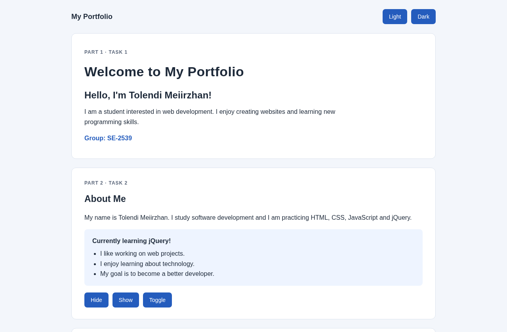
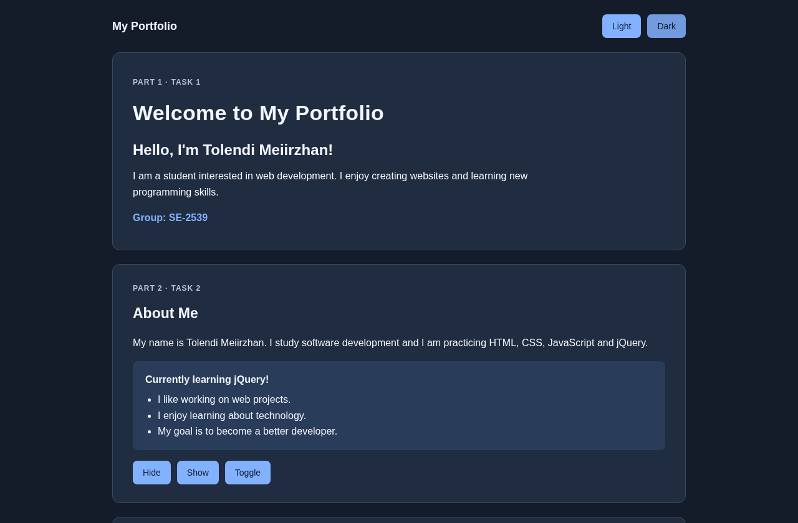
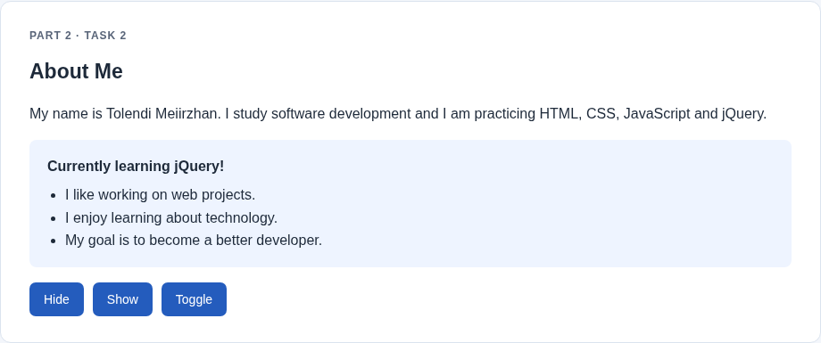
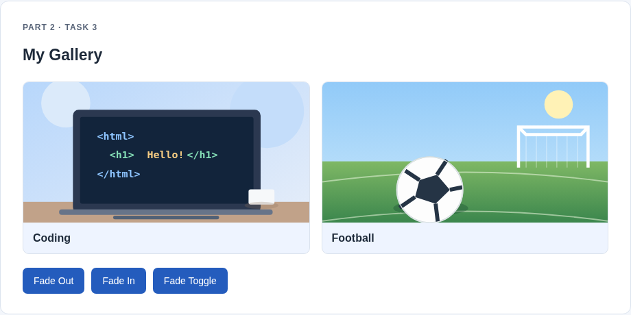
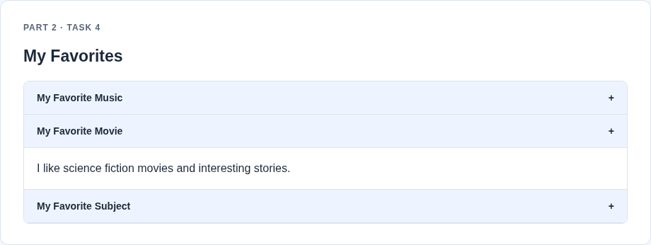
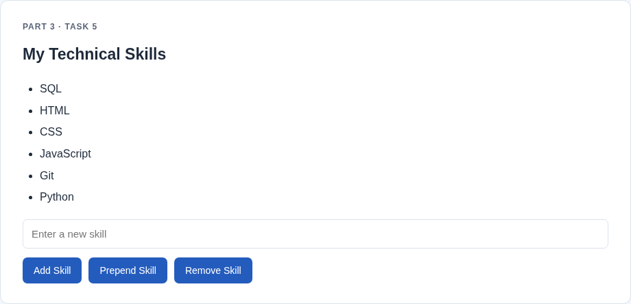
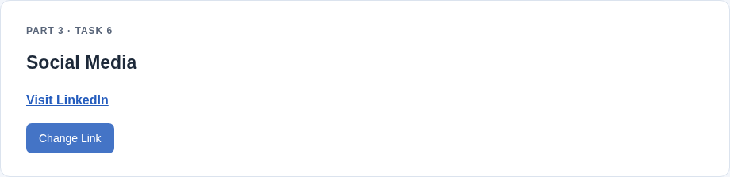
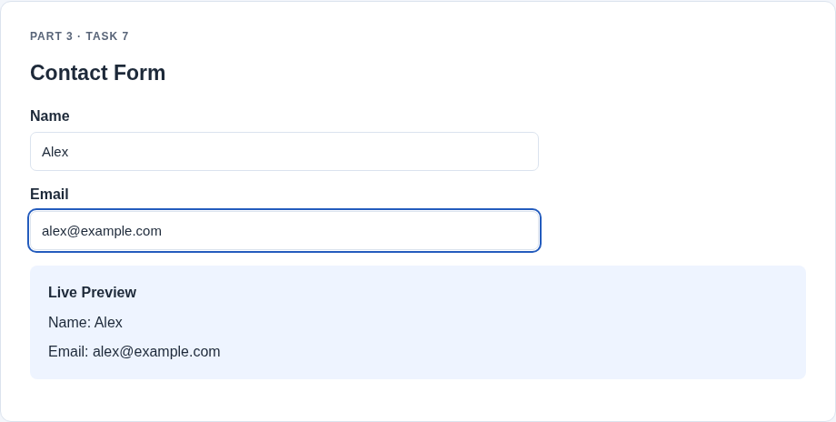
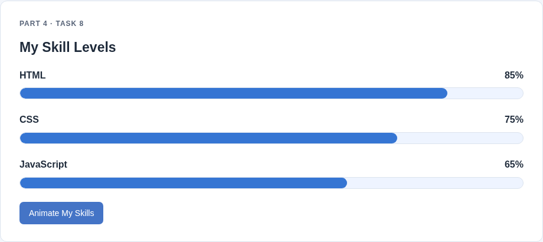

# Assignment #6. jQuery (Selectors, Effects, Animations)

**Name:** Tolendi Meiirzhan  
**Group:** SE-2539

## Part 1. Getting Started with jQuery

### Task 0. Setup

I connected jQuery from a CDN, used `$(document).ready()` and printed `jQuery is ready!` in the console.

### Task 1. Selectors & CSS

I created a profile with my name, headline and introduction. I used tag, ID and class selectors, changed the greeting with `.text()`, applied styles with `.css()` and added light and dark themes.

## Part 2. jQuery Effects

### Task 2. Visibility Methods

I added an About Me section with a short biography, current status and fun facts. The Hide, Show and Toggle buttons use `.hide()`, `.show()` and `.toggle()`.

### Task 3. Fade Methods

I added two gallery images and buttons that use `.fadeOut()`, `.fadeIn()` and `.fadeToggle()`.

### Task 4. Slide Methods

I added three clickable headings with collapsible panels. The panels open and close using `.slideUp()`, `.slideDown()` and `.slideToggle()`.

## Part 3. DOM Manipulation with jQuery

### Task 5. Add & Remove Elements

I created a list with four technical skills. A visitor can add a skill at the end with `.append()`, add one at the beginning with `.prepend()` and remove the last skill with `.remove()`. Empty values are not added.

### Task 6. Modifying Attributes

I added a social media link and a button that switches the link between GitHub and LinkedIn using `.attr()`.

### Task 7. Form Interaction

I created a form with Name and Email fields. The preview is updated while typing using `.val()` and `.text()`.

## Part 4. Animations

### Task 8. Basic Animation

I created three skill bars with different target widths. All bars start at zero. The Animate My Skills button uses `.animate()` to fill them, and clicking again returns them to zero.

## Work Process Summary

First, I made the portfolio structure in HTML and styled it with CSS. Then I connected jQuery, added event handlers for all buttons and implemented selectors, effects, DOM manipulation and animations. Finally, I tested the interactions and took screenshots of the completed tasks.
